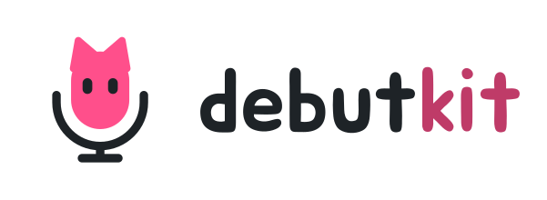

<div align="center">

<picture>
  <source media="(prefers-color-scheme: dark)" srcset="assets/brand/lockup/horizontal_dark-bg.svg">
  
</picture>

버튜버 방송 준비용 오픈소스 소프트웨어<br>
PC 점검, OBS 장면 구성, 통합 채팅창과 후원 알림, 방송 중 자동 클립

<a href="LICENSE"></a>

<a href="https://github.com/BudongJW/debutkit/actions/workflows/ci.yml"></a>


[프로젝트 사이트](https://budongjw.github.io/debutkit/) | [사용 설명서](https://budongjw.github.io/debutkit/guide.html) | [다운로드](https://github.com/BudongJW/debutkit/releases/latest)

</div>

## 개요

- 신규 버튜버의 방송 전 준비 작업(PC 점검, 장면 구성, 채팅 연결)을 하나의 프로그램으로 제공
- 지원 플랫폼: 치지직, SOOP, Twitch, YouTube
- 트래킹(VTube Studio 등)과 송출(OBS Studio)은 기존 프로그램을 사용하고, 프로그램 사이의 설정과 연결을 담당

## 기능

| 기능 | 명령 | 내용 |
|---|---|---|
| 설정 마법사 | `debutkit-gui` | PC 점검, 캐릭터, OBS 장면, 채팅과 알림, 마무리의 5단계 안내. 모든 기능을 창에서 사용 |
| PC 점검 | `debutkit doctor` | 메모리, CPU, 그래픽카드, 저장 공간, 마이크, 웹캠, OBS, 트래킹 프로그램, ffmpeg 점검 및 조치 안내. 아바타 모델(VRM) 사용 조건 확인, 업로드 속도 측정 |
| 캐릭터 | `debutkit character` | PNGTuber, 3D(VRM), Live2D 등록과 사용 조건 확인. PNGTuber와 VRM은 debutkit 캐릭터 화면으로 방송(OBS 마이크 음량으로 입 움직임, 웹캠 얼굴 추적). Live2D는 VTube Studio로 보내기 |
| OBS 장면 구성 | `debutkit scenes` | 대기 화면, 본방송, 토크, 자리 비움, 엔딩 장면 생성. 아바타 투명 배경 캡처, 채팅창과 후원 알림 연결 |
| 채팅창과 후원 알림 | `debutkit overlay` | OBS 브라우저 소스용 통합 채팅창과 후원 알림. 표시 형태 5종 |
| 방송 중 자동 클립 | `debutkit overlay --clip` | 채팅 급증 또는 스트리머와 매니저의 `!clip` 입력 시 OBS 리플레이 버퍼를 클립으로 저장 |
| 준비 도구 | `debutkit setup`, `debutkit chzzk` | ffmpeg 다운로드, 새 버전 확인, 치지직 공식 API 로그인 |

## 설치

### Windows

- [릴리스 페이지](https://github.com/BudongJW/debutkit/releases/latest)에서 설치 프로그램(`debutkit-버전-windows-x64-setup.exe`) 실행. 시작 메뉴에 debutkit 등록
- 설치 없이 사용하는 경우 `debutkit-버전-windows-x64.zip` 압축 해제 후 `debutkit-gui.exe` 실행
- 관리자 권한과 파이썬 설치 불필요. 자동 클립용 ffmpeg는 설치 과정 또는 설정 마법사에서 다운로드

### macOS, Linux

- macOS(Apple Silicon): `debutkit-버전-macos-arm64.zip` 압축 해제 후 debutkit.app 실행. 공증하지 않은 프로그램이므로 첫 실행은 Finder에서 우클릭 후 열기
- Linux(x64): `debutkit-버전-linux-x64.tar.gz` 압축 해제 후 `debutkit/debutkit-gui` 실행. Qt 실행에 `libxcb-cursor0` 등 그래픽 라이브러리 필요
- 파이썬 패키지로 설치하는 경우(Python 3.10 이상)

```bash
pip install "debutkit[gui] @ git+https://github.com/BudongJW/debutkit"
debutkit-gui
```

## 명령줄 사용 예

```bash
debutkit doctor --speed                # PC 점검과 업로드 속도 측정
debutkit scenes --replay-buffer        # OBS 장면 생성과 리플레이 버퍼 설정
debutkit setup --ffmpeg                # 자동 클립용 ffmpeg 다운로드(Windows)
debutkit overlay --chzzk https://chzzk.naver.com/live/채널ID --soop https://play.sooplive.co.kr/아이디 --clip
debutkit overlay --youtube https://www.youtube.com/watch?v=영상ID --youtube-key API키
debutkit youtube check https://www.youtube.com/watch?v=영상ID --youtube-key API키   # 방송 전 YouTube 연결 확인
debutkit character add 모델.vrm                 # 캐릭터 등록(VRM, Live2D 폴더나 zip, PNG는 character png)
debutkit character use 캐릭터                     # 방송에 사용. OBS 브라우저 소스 http://127.0.0.1:8790/character
debutkit overlay --chzzk 채널주소 --clip --save   # 채널과 옵션 저장
debutkit overlay --saved                         # 다음 방송부터 저장한 설정으로 실행
```

- OBS 장면 생성 전 OBS의 도구 메뉴에서 WebSocket 서버 사용 설정 필요
- 오버레이 설정 화면: http://127.0.0.1:8790 (OBS용 주소 복사, 표시 형태 선택, 미리보기, 시험 메시지)
- 본인 치지직 채널은 공식 API 사용 권장(`debutkit chzzk login` 실행 후 `debutkit overlay --chzzk-api`)
- YouTube 채팅은 스트리밍 방식(연결 1회 5 단위)을 우선 사용하고, 사용할 수 없으면 요청 방식으로 자동 전환
- 리플레이 버퍼를 처음 설정한 경우 OBS 재시작 후 사용 가능
- 설정 마법사와 `--save`는 채널 주소와 선택 항목을 이 PC에 저장(API 키, 비밀번호 제외). `debutkit settings`로 확인, `--clear`로 삭제
- 클립 저장 위치: `동영상/debutkit-clips` (`--clip-dir`로 변경)

전체 사용법은 [사용 설명서](https://budongjw.github.io/debutkit/guide.html) 참고

## 운영 원칙

| 항목 | 내용 |
|---|---|
| 무상 공개 | 모든 기능을 Apache-2.0으로 공개. 소속 프로그램 참여 여부와 무관 |
| 정보 수집 없음 | 사용 통계 미전송. 오버레이는 이 PC(127.0.0.1)에서만 접속 가능, 채팅 미저장 |
| 공식 API 우선 | 치지직과 YouTube는 공식 API 사용. 비공식 수신은 다른 채널 시험 용도 |
| 기존 프로그램 활용 | 트래킹(VTube Studio, VSeeFace 등)과 송출(OBS Studio)은 기존 프로그램 사용 |

## 소속 버튜버 프로그램

- 운영 팀이 버튜버 소속사(엔터테인먼트) 사업을 함께 준비 중
- 소속 의향 등록은 희망자에 한해 별도 접수. 미등록 사용자에게도 모든 기능을 동일하게 제공
- 등록은 계약이 아니며 언제든 철회 가능
- 운영 원칙: [docs/MEMBERSHIP.md](docs/MEMBERSHIP.md), [참여 안내](https://budongjw.github.io/debutkit/join.html)

## 문서

| 문서 | 내용 |
|---|---|
| [프로젝트 사이트](https://budongjw.github.io/debutkit/) | 다운로드, 사용 설명서, 방송 소프트웨어, 릴리스 노트 |
| [docs/SOFTWARE.md](docs/SOFTWARE.md) | 버튜버 방송 소프트웨어 목록과 debutkit의 역할 |
| [docs/SIMILAR_PROJECTS.md](docs/SIMILAR_PROJECTS.md) | 유사 프로젝트 조사 |
| [docs/MEMBERSHIP.md](docs/MEMBERSHIP.md) | 소속 참여 동의 구조, 법률 확인 목록 |
| [docs/ROADMAP.md](docs/ROADMAP.md) | 개발 계획, 검증 현황 |
| [docs/RELEASING.md](docs/RELEASING.md) | 릴리스 절차, 코드 서명 |
| [CONTRIBUTING.md](CONTRIBUTING.md) | 기여 방법(DCO 서명), 표기 원칙 |

## 개발

```bash
git clone https://github.com/BudongJW/debutkit && cd debutkit
python -m venv .venv && .venv/Scripts/activate      # macOS, Linux: source .venv/bin/activate
pip install -e ".[gui,dev]"
pytest -q && ruff check .
```

- Windows 실행 파일: `pip install -e ".[gui,build]"` 후 `python packaging/build_windows.py`. 생성한 프로그램을 파이썬 없이 실행해 동작 확인. `--installer` 지정 시 설치 프로그램도 생성(Inno Setup 6 필요)
- macOS, Linux 실행 파일: `python packaging/build_app.py`(각 운영체제에서 실행)
- 릴리스: [docs/RELEASING.md](docs/RELEASING.md). `v*` 태그 push 시 GitHub Actions가 운영체제별 배포 파일을 만들어 첨부하고, Windows, macOS, Linux의 실제 OBS 검증(`verify.yml`)을 실행
- 프로젝트 사이트: `site/` 수정 후 `python packaging/build_site.py`로 확인. main 반영 시 GitHub Pages에 자동 배포

## 라이선스

[Apache-2.0](LICENSE). 연동하는 외부 프로그램(OBS Studio, VTube Studio 등)에는 각 프로그램의 라이선스 적용
