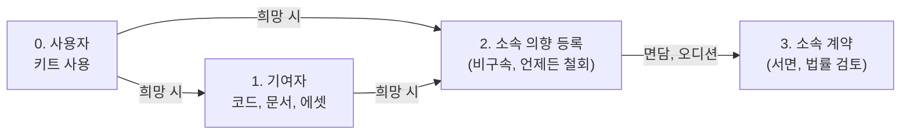

# 소속 버튜버 프로그램 참여 동의 구조

- 성격: 운영 원칙과 설계안. 법률 자문 아님
- 실제 모집과 계약 전 변호사 검토 필수
- 사업 조건(소속사 이름, 수익 배분, IP 귀속)은 미정 항목으로 `[결정 필요]` 표시

## 기본 원칙

- debutkit은 Apache-2.0 오픈소스로 공개
- 소속 여부와 무관하게 모든 기능을 동일하게 제공. 소속 동의는 사용과 기여의 조건이 아님

| 근거 | 내용 |
|---|---|
| 오픈소스 정의 | 라이선스에 소속 동의 같은 조건을 붙이면 오픈소스 요건을 충족하지 못함(OSI 오픈소스 정의의 사람, 분야 차별 금지). Apache-2.0으로 공개한 코드는 소속 여부와 무관하게 같은 권리 부여 |
| 개인정보보호법 | 서비스에 필요한 최소 정보 외의 수집에 동의하지 않았다는 이유로 서비스 제공 거부 불가(개인정보보호법 제16조 제3항). 소속 신청 정보는 키트 사용에 필요하지 않은 정보 |
| 신뢰 | 버튜버 지망생의 주요 우려는 신원 노출과 불리한 계약. 강요가 없는 구조여야 지원자 확보 가능 |

## 참여 단계

| 단계 | 내용 | 동의 | 수집 정보 |
|:---:|---|---|---|
| 0. 사용자 | 키트 설치, 방송 | 없음. 사용 통계(텔레메트리) 미전송 | 없음 |
| 1. 기여자 | PR, 이슈, 번역, 에셋 | 커밋마다 DCO 서명(`git commit -s`). [CONTRIBUTING.md](../CONTRIBUTING.md) | GitHub 공개 정보 |
| 2. 소속 의향 등록 | 신청서 제출 | 개인정보 수집, 이용 동의(필수 1건, 선택 1건). 계약 아님 | 최소 정보: 활동명, 이메일, 연령대 확인 등. [신청서 양식](../membership/APPLICATION.md) |
| 3. 소속 계약 | 면담, 오디션, 계약 | 서면 계약서. 미성년자는 법정대리인 동의 | 계약에 필요한 정보(실명 등)는 이 단계에서 처음 수집 |

### 키트 안의 소속 안내 방식

- 안내 위치: README 한 줄, 사이트 참여 안내 페이지, `debutkit doctor` 결과 끝 한 줄(키트 사용과 무관함 명시), 설정 마법사 마무리 단계 한 줄
- 사용하지 않는 방식: 실행할 때마다 표시되는 팝업, 기능 잠금, 신청 전까지 반복되는 알림, 자동 정보 전송, 다른 기능 동의와 묶은 체크박스
- 신청은 사용자가 링크를 눌러 신청서로 이동한 경우에만 진행

## 2단계 소속 의향 등록의 동의 설계 기준

| 항목 | 기준 |
|---|---|
| 분리 | 키트 사용, 기여, 마케팅 수신과 별도 화면, 별도 체크. 미리 체크된 상자 사용 금지 |
| 고지 | 수집 목적, 항목, 보유 및 이용 기간, 동의 거부 권리와 거부 시 불이익(소속 심사 불가 외 없음)을 동의 직전 표시(개인정보보호법 제15조 제2항) |
| 최소 수집 | 실명, 주민등록번호, 주소, 얼굴 사진, 음성 원본은 이 단계에서 수집하지 않음 |
| 연령 | 만 14세 미만은 법정대리인 동의 없이 개인정보 수집 불가(제22조의2). 미성년자(만 19세 미만)는 계약 단계에서 법정대리인 동의 필수(민법 제5조) |
| 비구속 | 신청서 첫 화면과 제출 직전에 소속 계약이 아니며 의무가 없음을 표시 |
| 철회 | 이메일 한 통으로 철회와 삭제. 철회 즉시 파기하고 파기 사실 회신 |
| 보관 | 동의 일시와 동의 문안 버전을 함께 저장(문안 변경 후에도 동의 내용 증명) |
| 보유 기간 | 심사 종료 후 [결정 필요: 예 6개월] 경과 시 파기. 재지원 의사를 별도로 밝힌 경우에만 연장 |
| 저장 위치 | 공개 저장소(GitHub 이슈 등) 접수 금지. 접근 권한을 제한한 양식과 저장소 사용 |
| 신원 보호 | 캐릭터와 실제 인물의 분리가 기본 전제. 신청자의 실제 신원은 운영 담당자 외 공유 금지 |

## 3단계 소속 계약의 법률 확인 목록

- 실제 계약 전 변호사와 확인할 항목
- 확인하지 않은 조항 번호는 적지 않음

| 확인 항목 | 내용 |
|---|---|
| 대중문화예술기획업 등록 | 대중문화예술산업발전법상 등록 대상 여부(버튜버 매니지먼트 해당 여부) 확인. 해당 시 등록 후 영업 |
| 표준전속계약서 | 공정거래위원회 대중문화예술인 표준전속계약서 기준(계약 기간 상한 등). 1인 크리에이터, MCN 계약 관행과 비교 |
| 청소년 출연자 보호 | 미성년 활동자의 활동 시간 제한, 학습권, 수익 관리 규정 확인 |
| 개인정보 처리방침 | 계약 단계의 수집 항목(실명, 정산 정보 등), 위탁(정산, 세무), 파기 |
| 캐릭터 IP 귀속 | [결정 필요] 본인 소유, 회사 소유, 공동 소유 중 선택과 졸업 시 처리. 지원자가 가장 중시하는 조건이므로 모집 공고에 사전 공개 권장 |
| 아바타 제작비 | [결정 필요] 회사 부담 여부, 졸업 시 모델 소유권, Live2D와 VRM 모델의 법인 사용 허락(판매 모델 대부분 개인 사용만 허락) |
| 방송 프로그램 라이선스 | 소속사 규모에 따라 VTube Studio Company License(구독형), Live2D 사업용 라이선스, Warudo Pro가 필요할 수 있음. 비용 부담 주체 [결정 필요]. 상세: [SOFTWARE.md](SOFTWARE.md#소속사-운영-시-라이선스) |
| 수익 배분 | [결정 필요] 후원, 광고, 굿즈, 클립 수익의 배분 비율과 정산 주기 |
| 해지 | 위약금 상한, 해지 사유, 해지 후 활동 제한(경업 금지)의 범위와 기간 |

## 기여자 우대 기준

- 허용: 오디션에서 기여 이력을 참고 자료로 활용
- 금지: 소속 조건으로 기여 요구, 기여자에게 소속 요구
- 기여 관리는 DCO로만 진행

## 미결정 사항

1. 소속사(엔터테인먼트) 이름과 법인 형태
2. 캐릭터 IP 귀속 원칙
3. 신청서 운영 도구(구글 폼, Tally, 자체 양식 등), 저장 위치, 담당자
4. 개인정보 보유 기간
5. 모집 시작 시점과 1기 인원
