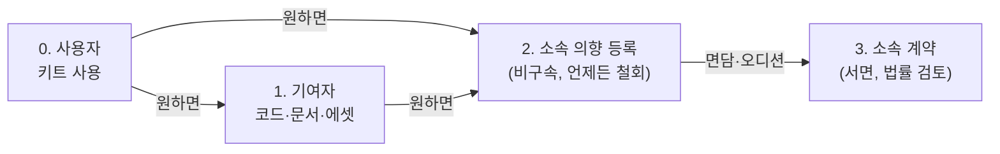

# 소속 버튜버 프로그램: 참여 동의 구조

> 이 문서는 운영 원칙과 설계안이다. 법률 자문이 아니며, 실제 모집과 계약 전에 변호사 검토를 받아야 한다. 소속사 이름, 수익 배분, IP 귀속 같은 사업 조건은 비워 두었다(`[결정 필요]`).

## 핵심 원칙: 키트는 조건 없이, 소속은 따로 선택

debutkit은 Apache-2.0 오픈소스다. **누구나 소속 여부와 무관하게 모든 기능을 쓸 수 있고, 소속 동의는 사용이나 기여의 조건이 아니다.** 이렇게 나누는 이유는 세 가지다.

| 이유 | 내용 |
|---|---|
| 오픈소스 정의 | 라이선스에 "쓰려면 소속에 동의" 같은 조건을 붙이면 오픈소스가 아니게 된다(OSI 오픈소스 정의의 사람·분야 차별 금지). Apache-2.0으로 공개한 코드는 소속 여부와 무관하게 누구에게나 같은 권리를 준다 |
| 개인정보보호법 | 서비스에 필요한 최소 정보 외의 수집에 동의하지 않는다는 이유로 서비스 제공을 거부할 수 없다(개인정보보호법 제16조 제3항). 소속 신청 정보는 키트 사용에 필요 없는 정보다 |
| 신뢰 | 버튜버 지망생은 신원 노출과 불리한 계약을 가장 두려워한다. "강요하지 않는다"가 보여야 지원자가 모인다 |

## 참여 단계

| 단계 | 하는 일 | 동의 | 수집 정보 |
|:---:|---|---|---|
| 0. 사용자 | 키트 설치, 방송 | 없음. 사용 통계(텔레메트리)도 보내지 않음 | 없음 |
| 1. 기여자 | PR, 이슈, 번역, 에셋 | 커밋마다 DCO 서명(`git commit -s`). [CONTRIBUTING.md](../CONTRIBUTING.md) | GitHub에 공개되는 것뿐 |
| 2. 소속 의향 등록 | 신청서 제출 | 개인정보 수집·이용 동의(필수 1건, 선택 1건). **계약 아님** | 최소한: 활동명, 이메일, 연령대 확인 등. [신청서 양식](../membership/APPLICATION.md) |
| 3. 소속 계약 | 면담, 오디션, 계약 | 서면 계약서. 미성년자는 법정대리인 동의 | 계약에 필요한 범위(실명 등)는 이 단계에서 처음 받음 |

### 키트 안에서 소속을 알리는 방식

- 알리는 곳: README의 한 줄, 블로그의 모집 글, `debutkit doctor` 결과 끝의 안내 한 줄("키트 사용과는 무관합니다").
- 하지 않는 것: 실행할 때마다 뜨는 팝업, 기능 잠금, 신청 전까지 반복되는 알림, 자동 정보 전송, 다른 기능 동의와 묶은 체크박스.
- 신청은 사용자가 링크를 눌러 신청서로 가는 경우에만 일어난다.

## 2단계 소속 의향 등록: 동의 설계 체크리스트

| 항목 | 기준 |
|---|---|
| 분리 | 키트 사용, 기여, 마케팅 수신과 **별도 화면·별도 체크**. 미리 체크된 상자 금지 |
| 고지 | 수집 목적, 항목, 보유·이용 기간, 동의 거부 권리와 거부 시 불이익(소속 심사 불가 외 없음)을 동의 직전에 표시(개인정보보호법 제15조 제2항) |
| 최소 수집 | 실명, 주민등록번호, 주소, 얼굴 사진, 음성 원본은 이 단계에서 받지 않음 |
| 연령 | 만 14세 미만은 법정대리인 동의 없이 개인정보를 받지 않음(제22조의2). 미성년자(만 19세 미만)는 계약 단계에서 법정대리인 동의 필수(민법 제5조) |
| 비구속 | "이 신청은 소속 계약이 아니며 어떤 의무도 생기지 않는다"를 신청서 맨 위와 제출 직전에 표시 |
| 철회 | 이메일 한 통으로 철회와 삭제. 철회 후 지체 없이 파기하고 파기 사실 회신 |
| 보관 | 동의 일시, 동의한 문안 버전을 함께 저장(문안이 바뀌어도 무엇에 동의했는지 증명) |
| 보유 기간 | 심사 종료 후 [결정 필요: 예 6개월] 뒤 파기. 재지원 의사를 따로 밝힌 경우만 연장 |
| 저장 위치 | 공개 저장소(GitHub 이슈 등)에 절대 받지 않음. 접근 권한이 제한된 양식·저장소 사용 |
| 신원 보호 | 버튜버는 "캐릭터와 사람의 분리"가 핵심. 신청자의 실제 신원은 운영 담당자 외 누구에게도 공유하지 않음 |

## 3단계 소속 계약: 법률 확인 목록

아래는 실제 계약 전에 변호사와 확인할 목록이다. 조항 번호는 확인되지 않은 것은 적지 않았다.

| 확인할 것 | 메모 |
|---|---|
| 대중문화예술기획업 등록 | 대중문화예술산업발전법상 등록 대상인지(버튜버 매니지먼트가 해당하는지) 확인. 해당하면 등록 후 영업 |
| 표준전속계약서 | 공정거래위원회 대중문화예술인 표준전속계약서를 기준으로 시작(계약 기간 상한 등). 1인 크리에이터·MCN 계약 관행과 비교 |
| 청소년 출연자 보호 | 미성년 활동자의 활동 시간 제한, 학습권, 수익 관리 규정 확인 |
| 개인정보 처리방침 | 계약 단계의 수집 항목(실명, 정산 정보 등), 위탁(정산·세무), 파기 |
| 캐릭터 IP 귀속 | **[결정 필요]** 본인 소유 / 회사 소유 / 공동 소유와 졸업 시 처리. 지원자에게 가장 중요한 조건이므로 모집 글에 미리 공개 권장 |
| 아바타 제작비 | **[결정 필요]** 회사 부담 여부, 졸업 시 모델 소유권, Live2D·VRM 모델의 법인 사용 허락(판매 모델은 대부분 개인 사용만 허락) |
| 방송 프로그램 라이선스 | 소속사 규모에 따라 VTube Studio Company License(구독형), Live2D 사업용 라이선스, Warudo Pro가 필요할 수 있음. 비용 부담 주체 **[결정 필요]**. 상세: [SOFTWARE.md](SOFTWARE.md#소속사-운영-시-라이선스) |
| 수익 배분 | **[결정 필요]** 후원, 광고, 굿즈, 클립(stream2clip 결과물) 수익의 배분 비율과 정산 주기 |
| 해지 | 위약금 상한, 해지 사유, 해지 후 활동 제한(경업 금지)의 범위와 기간 |

## 기여자 우대에 대해

기여자가 오디션에서 우대받는 구조는 가능하지만, "소속하려면 기여해야 한다"나 "기여하면 소속해야 한다"는 구조는 피한다. 기여는 DCO로만 관리하고, 기여 사실은 소속 심사에서 참고 자료일 뿐이다.

## 열린 결정 사항

1. 소속사(엔터) 이름과 법인 형태
2. 캐릭터 IP 귀속 원칙
3. 신청서 운영 도구(구글 폼, Tally, 자체 양식 등)와 저장 위치, 담당자
4. 개인정보 보유 기간
5. 모집 시작 시점과 1기 인원
