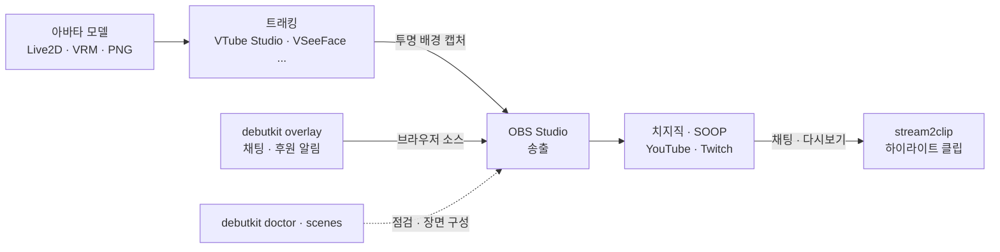

# 버튜버 방송에 필요한 소프트웨어

> 기준일 2026-11-21. 새로 데뷔하는 버튜버(치지직, SOOP, YouTube, Twitch)가 첫 방송까지 필요한 소프트웨어와, debutkit이 각각을 **만들지 / 연결할지 / 안내만 할지** 정리했다. 라이선스·가격은 바뀔 수 있으니 설치 전에 공식 페이지를 확인할 것.

## 한눈에 보기

| 단계 | 꼭 필요 | 선택 | debutkit의 역할 |
|---|---|---|---|
| 1. 아바타 만들기 | 모델 1개(Live2D, VRM, PNG 중) | 직접 제작 도구 | **안내 + 점검**: 모델의 영리·법인 사용 허락 확인(`doctor --avatar`) |
| 2. 아바타 움직이기 | 트래킹 프로그램 1개 + 웹캠(또는 아이폰) | 손 트래킹 | **점검 + 연결**: 설치 확인, OBS에 투명 배경으로 연결(`scenes`) |
| 3. 송출 | OBS Studio | PRISM Live Studio | **연결**: 장면 세트 자동 구성(`scenes`) |
| 4. 소리 | 마이크 + 잡음 제거 | 음성 믹서, 음성 변조 | **안내** |
| 5. 채팅·후원 | 플랫폼 내장 위젯 또는 오버레이 | 후원 서비스 | **제작**: 통합 채팅창·알림(`overlay`) |
| 6. 방송 후 | (없음) | 클립, 편집 | **연결**: stream2clip |

## 1. 아바타 만들기

| 소프트웨어 | 종류 | 라이선스·가격 | 메모 |
|---|---|---|---|
| Live2D Cubism Editor | 2D 모델 제작 | 독점. FREE판(기능 제한)과 PRO판(유료) | 한국·일본 버튜버의 사실상 표준. 직접 리깅은 학습량이 큼 |
| VRoid Studio | 3D(VRM) 모델 제작 | 무료(독점) | 무료로 3D 아바타를 가장 빨리 만드는 방법 |
| Blender + VRM Add-on | 3D 편집 | GPL / MIT | 모델 수정, 의상 추가 |
| 판매 모델·외주 | BOOTH, nizima 등 | 상품별 약관 | **대부분 개인 사용만 허락. 기획사 소속 활동(법인 사용)은 별도 허락 필요** |
| PNG 2장(눈·입) | PNGTuber | - | 가장 싼 시작. 트래킹 없이 목소리로 움직임 |

- 모델 약관 확인이 소속 활동의 첫 관문. VRM은 파일 안에 사용 조건이 들어 있어 `debutkit doctor --avatar 모델.vrm --agency` 로 자동 확인 가능(stream2clip `vrm` 사용).
- Live2D는 연매출 기준에 따라 별도 라이선스 조건이 붙는다. 소속사 규모가 커지면 확인 필요.

## 2. 아바타 움직이기 (트래킹)

| 소프트웨어 | 모델 | 라이선스·가격 | 메모 |
|---|---|---|---|
| VTube Studio | Live2D | 독점. Steam 무료, 워터마크 제거 유료 DLC | Live2D 표준. 아이폰 얼굴 트래킹 연동. 플러그인 API(포트 8001)를 stream2clip 방송 기록기가 사용 |
| VSeeFace | VRM | 무료(독점) | 3D 표준. 트래커는 오픈소스 OpenSeeFace |
| Warudo | VRM 등 | 무료(독점) | 연출·블루프린트 기능이 강함 |
| VMagicMirror | VRM | MIT | 오픈소스. 키보드·마우스 동작 표현 |
| OpenSeeFace | 트래킹 엔진 | BSD-2 | 웹캠 얼굴 트래킹 부품 |
| PNGTuber-Remix, veadotube mini | PNG | 프로그램별 | PNGTuber용 |

- OBS 연결은 **게임 캡처 + 투명도 허용**(Windows)이 공식 권장 방식. 그린스크린은 권장하지 않음(VTube Studio 위키). `debutkit scenes` 가 이 설정으로 만든다.

## 3. 송출

| 소프트웨어 | 라이선스·가격 | 메모 |
|---|---|---|
| OBS Studio | GPL-2.0, 무료 | 표준. 30 이후 버전에 WebSocket 원격 제어 내장 → `debutkit scenes`, stream2clip 리플레이가 사용 |
| PRISM Live Studio (네이버) | 무료 | 국내 플랫폼 동시 송출이 쉬움 |
| Streamlabs Desktop | 무료 + 유료 구독 | 위젯 일체형 |

## 4. 소리

| 소프트웨어 | 라이선스·가격 | 메모 |
|---|---|---|
| OBS 내장 잡음 제거(RNNoise) | OBS에 포함 | 가장 먼저 켤 것 |
| NVIDIA Broadcast | 무료(RTX 필요) | 잡음·에코 제거 |
| VoiceMeeter | 기부형 무료 | 게임·디스코드·BGM 소리 분리 |
| 음성 변조(RVC 등) | 프로그램별 | 남의 목소리로 학습한 모델은 쓰지 않기. 본인 목소리 기반만 |
| BGM | 저작권 프리 음원 | 플랫폼마다 음원 정책이 다름. 클립 수익화 전 확인 |

## 5. 채팅·후원

| 소프트웨어 | 플랫폼 | 메모 |
|---|---|---|
| 플랫폼 내장 위젯 | 치지직, SOOP | 가장 간단. 한 플랫폼만 쓰면 충분 |
| 투네이션 등 후원 서비스 | 여러 플랫폼 | 후원 알림, 룰렛 등 |
| Social Stream Ninja | 120개 이상 | GPL-3.0. 브라우저 확장 방식 |
| **debutkit overlay** | 치지직(공식 API / 시청자 읽기), SOOP, Twitch | 동시 송출 채팅을 한 화면에. 내 PC에서만 열리고 저장 안 함 |

## 6. 방송 후

| 소프트웨어 | 메모 |
|---|---|
| **stream2clip** | 채팅 반응으로 하이라이트를 찾아 9:16 클립, 카라오케 자막, 기획사 가이드라인 점검 |
| DaVinci Resolve | 무료 편집기. stream2clip의 EDL·마커 내보내기와 연결 |

## 플랫폼 API

| 플랫폼 | 공식 경로 | debutkit |
|---|---|---|
| 치지직 | CHZZK Open API Session(내 채널의 채팅·후원·구독) | `--chzzk-api` (stream2clip 로그인 공유) |
| SOOP | 자체 위젯 URL. 공식 Open API의 채팅 이벤트는 확인 중 | 시청자 읽기 |
| YouTube | Live Streaming API(liveChatMessages, 할당량 있음) | 0.3 예정 |
| Twitch | IRC/EventSub | 익명 IRC 읽기 |

## debutkit이 만들지 않는 것

트래킹 엔진, 송출 프로그램, 모델 제작 도구는 이미 좋은 프로그램이 있고 대부분 독점 소프트웨어라 번들할 수도 없다. debutkit은 이들을 **설치 여부 점검 → 설정 연결 → 사용 안내**로만 다룬다.
