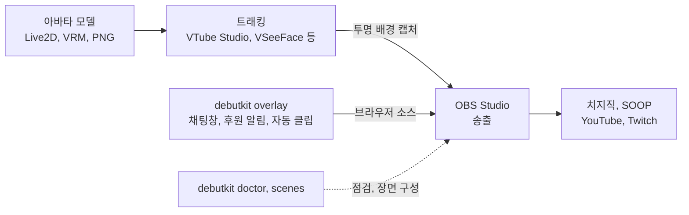

# 버튜버 방송 소프트웨어

- 기준일: 2026-11-21
- 대상: 치지직, SOOP, YouTube, Twitch에서 활동을 시작하는 버튜버
- 내용: 첫 방송에 필요한 소프트웨어와 항목별 debutkit의 역할(제작, 연결, 안내)
- 라이선스와 가격은 변경될 수 있으므로 설치 전 공식 페이지에서 확인 필요

## 구성도

| 단계 | 필수 | 선택 | debutkit 역할 |
|---|---|---|---|
| 1. 아바타 제작 | 모델 1개(Live2D, VRM, PNG 중) | 직접 제작 도구 | 안내, 점검. 모델의 영리, 법인 사용 허락 확인(`doctor --avatar`) |
| 2. 아바타 구동 | 트래킹 프로그램 1개, 웹캠 또는 아이폰 | 손 트래킹 | 점검, 연결. 설치 확인, OBS 투명 배경 연결(`scenes`) |
| 3. 송출 | OBS Studio | PRISM Live Studio | 연결. 장면 자동 구성(`scenes`), 업로드 속도 측정(`doctor --speed`) |
| 4. 음향 | 마이크, 잡음 제거 | 음성 믹서, 음성 변조 | 안내, 점검. 마이크 인식 확인 |
| 5. 채팅과 후원 | 플랫폼 기본 위젯 또는 오버레이 | 후원 서비스 | 제작. 통합 채팅창, 후원 알림(`overlay`) |
| 6. 방송 후 | 없음 | 클립 편집 | 제작. 방송 중 자동 클립(`overlay --clip`) |

## 1. 아바타 제작

| 소프트웨어 | 종류 | 라이선스, 가격 | 비고 |
|---|---|---|---|
| Live2D Cubism Editor | 2D 모델 제작 | 독점. FREE판(기능 제한), PRO판(유료) | 국내외 버튜버의 표준 도구. 직접 리깅은 학습 부담이 큼 |
| VRoid Studio | 3D(VRM) 모델 제작 | 무료(독점) | 무료 3D 아바타 제작 수단 중 소요 시간이 가장 짧음 |
| Blender, VRM Add-on | 3D 편집 | GPL, MIT | 모델 수정, 의상 추가 |
| 판매 모델, 외주 제작 | BOOTH, nizima 등 | 상품별 약관 | 대부분 개인 사용만 허락. 소속사 활동(법인 사용)은 별도 허락 필요 |
| PNG 2장(눈, 입) | PNGTuber | 해당 없음 | 비용이 가장 적은 방식. 트래킹 없이 음성으로 구동 |

- 소속 활동 전 모델 약관 확인 필요
- VRM은 파일 안에 사용 조건이 포함되어 `debutkit doctor --avatar 모델.vrm --agency`로 자동 확인 가능
- Live2D는 연매출 기준의 별도 라이선스 조건이 있어 소속사 규모가 커지면 확인 필요

## 2. 아바타 구동(트래킹)

| 소프트웨어 | 모델 | 라이선스, 가격 | 비고 |
|---|---|---|---|
| VTube Studio | Live2D | 독점. 개인은 무료로 시작, 수익 방송(후원, 수익 창출 채널 등)은 유료 버전(DLC) 구매 필요. 회사 사용 조건은 [소속사 운영 시 라이선스](#소속사-운영-시-라이선스) 참고 | Live2D 표준. 아이폰 얼굴 트래킹 연동. 플러그인 API 포트 8001 |
| VSeeFace | VRM | 무료(독점). 상업적 이용 허용, 프로그램 수정 금지 | 3D 표준. 트래커는 오픈소스 OpenSeeFace |
| Warudo | VRM 등 | Steam판 무료(독점). 기업용 Warudo Pro 별도(가격 문의) | 연출, 블루프린트 기능 제공 |
| VMagicMirror | VRM | MIT | 오픈소스. 키보드와 마우스 동작 표현 |
| OpenSeeFace | 트래킹 엔진 | BSD-2 | 웹캠 얼굴 트래킹 구성 요소 |
| PNGTuber-Remix, veadotube mini | PNG | 프로그램별 상이 | PNGTuber용 |

- OBS 연결의 공식 권장 방식은 게임 캡처의 투명도 허용(Windows). 그린스크린은 권장하지 않음(VTube Studio 위키)
- `debutkit scenes`는 이 방식으로 아바타 소스 생성

## 3. 송출

| 소프트웨어 | 라이선스, 가격 | 비고 |
|---|---|---|
| OBS Studio | GPL-2.0, 무료 | 표준. 28 이후 버전에 WebSocket 원격 제어(obs-websocket 5) 내장. `debutkit scenes`와 자동 클립이 사용 |
| PRISM Live Studio(네이버) | 무료 | 국내 플랫폼 동시 송출 지원 |
| Streamlabs Desktop | 무료, 유료 구독 | 위젯 일체형 |

## 4. 음향

| 소프트웨어 | 라이선스, 가격 | 비고 |
|---|---|---|
| OBS 내장 잡음 제거(RNNoise) | OBS에 포함 | 가장 먼저 적용할 설정 |
| NVIDIA Broadcast | 무료(RTX 그래픽카드 필요) | 잡음, 에코 제거 |
| VoiceMeeter | 기부형 무료 | 게임, 디스코드, 배경 음악의 음향 분리 |
| 음성 변조(RVC 등) | 프로그램별 상이 | 타인 목소리로 학습한 모델 사용 금지. 본인 목소리 기반 모델만 사용 |
| 배경 음악 | 저작권 프리 음원 | 플랫폼별 음원 정책 상이. 클립 수익화 전 확인 필요 |

## 5. 채팅과 후원

| 소프트웨어 | 플랫폼 | 비고 |
|---|---|---|
| 플랫폼 기본 위젯 | 치지직, SOOP | 구성이 가장 간단함. 단일 플랫폼 방송에 적합 |
| 투네이션 등 후원 서비스 | 여러 플랫폼 | 후원 알림, 룰렛 등 |
| Social Stream Ninja | 120개 이상 | GPL-3.0. 브라우저 확장 방식 |
| debutkit overlay | 치지직(공식 API, 비공식 수신), SOOP, Twitch, YouTube(공식 API) | 동시 송출 채팅 통합. 이 PC에서만 접속 가능, 채팅 미저장 |

## 6. 방송 후

| 소프트웨어 | 비고 |
|---|---|
| debutkit overlay --clip | 방송 중 채팅 급증 시점과 스트리머의 `!clip` 입력 시점을 OBS 리플레이 버퍼로 저장 |
| DaVinci Resolve | 무료 편집기. 저장한 클립 편집 |

## 플랫폼 API

| 플랫폼 | 공식 경로 | debutkit |
|---|---|---|
| 치지직 | CHZZK Open API Session(본인 채널의 채팅, 후원, 구독) | `debutkit chzzk login` 실행 후 `--chzzk-api` |
| SOOP | 자체 위젯 주소. 공식 Open API의 채팅 이벤트 제공 여부 확인 중 | 비공식 수신 |
| YouTube | YouTube Data API 라이브 채팅(liveChatMessages, API 키, 일일 할당량) | `--youtube`, `--youtube-key` |
| Twitch | IRC, EventSub | 익명 IRC 수신 |

## 소속사 운영 시 라이선스

- 개인에게 무료인 프로그램도 회사(소속사)가 사용하면 조건이 달라짐
- 소속 계약 전 확인 필요

| 대상 | 조건 | 출처 |
|---|---|---|
| VTube Studio | 개인: 수익 방송 시 유료 버전(DLC) 구매. 회사: 직전 연도 수입이 미화 20만 달러를 넘는 회사는 Company License 필요, 해당 규모의 버튜버 소속사는 구독형 Company License(support@denchisoft.com 견적). 모바일 앱은 기기별 구매 | [VTube Studio EULA (Steam)](https://store.steampowered.com/eula/1325860_eula_0) |
| Live2D(VTube Studio 경유 포함) | 앱이 사업의 주요 요소이고 연매출이 2,000만 엔을 넘는 경우(예: 버튜버 방송 사업) Live2D Inc.의 별도 라이선스가 필요할 수 있음 | 같은 EULA |
| Warudo | 기업 사용자용 Warudo Pro 별도(가격 문의, info@warudo.app). 인디 가격은 IP와 계정을 본인이 소유하고 방송 시간 의무 계약이 없는 개인 대상. 무료 Steam판의 회사 사용 조건은 명시되지 않아 문의 필요 | [Warudo Pro 문서](https://docs.warudo.app/docs/pro) (2026-01-13 갱신) |
| VSeeFace | 상업적 이용 허용. 회사 대상 별도 제한 없음. 프로그램 수정 금지 | [vseeface.icu](https://www.vseeface.icu/) Terms of use |
| 아바타 모델 | 판매 모델 대부분 개인 사용만 허락. 법인 사용은 제작자 허락 필요. VRM은 `doctor --avatar --agency`로 확인 | 모델별 약관 |

## 확인 현황

- 2026-11-21 1차 출처 확인: VTube Studio, Warudo Pro, VSeeFace 약관(위 표), OBS, CHZZK 공식 API, SOOP 위젯
- 2026-11-18 확인: Live2D, VRM, VMagicMirror, OpenSeeFace
- 재확인 필요: PRISM, Streamlabs, NVIDIA Broadcast, VoiceMeeter, 투네이션의 가격과 라이선스

## debutkit의 범위

- 개발 대상 아님: 트래킹 엔진, 송출 프로그램, 모델 제작 도구. 기존 프로그램이 충분하고 대부분 독점 소프트웨어여서 함께 배포할 수 없음
- 담당 범위: 설치 여부 점검, 설정 연결, 사용 안내
