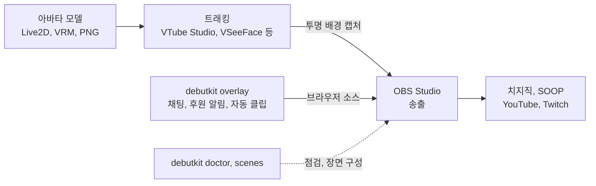

# 버튜버 방송에 필요한 소프트웨어

- 기준일: 2026-11-21
- 대상: 치지직, SOOP, YouTube, Twitch에서 새로 데뷔하는 버튜버
- 내용: 첫 방송까지 필요한 소프트웨어, 항목별 debutkit 역할(제작, 연결, 안내)
- 라이선스와 가격은 변동 가능. 설치 전 공식 페이지 확인

## 요약

| 단계 | 필수 | 선택 | debutkit 역할 |
|---|---|---|---|
| 1. 아바타 제작 | 모델 1개(Live2D, VRM, PNG 중) | 직접 제작 도구 | **안내, 점검**: 모델의 영리, 법인 사용 허락 확인(`doctor --avatar`) |
| 2. 아바타 구동 | 트래킹 프로그램 1개, 웹캠(또는 아이폰) | 손 트래킹 | **점검, 연결**: 설치 확인, OBS 투명 배경 연결(`scenes`) |
| 3. 송출 | OBS Studio | PRISM Live Studio | **연결**: 장면 세트 자동 구성(`scenes`) |
| 4. 소리 | 마이크, 잡음 제거 | 음성 믹서, 음성 변조 | **안내** |
| 5. 채팅과 후원 | 플랫폼 내장 위젯 또는 오버레이 | 후원 서비스 | **제작**: 통합 채팅창, 알림(`overlay`) |
| 6. 방송 후 | 없음 | 클립, 편집 | **제작**: 방송 중 자동 클립(`overlay --clip`) |

## 1. 아바타 제작

| 소프트웨어 | 종류 | 라이선스, 가격 | 메모 |
|---|---|---|---|
| Live2D Cubism Editor | 2D 모델 제작 | 독점. FREE판(기능 제한), PRO판(유료) | 한국, 일본 버튜버의 사실상 표준. 직접 리깅은 학습량 큼 |
| VRoid Studio | 3D(VRM) 모델 제작 | 무료(독점) | 무료 3D 아바타 제작의 가장 빠른 방법 |
| Blender, VRM Add-on | 3D 편집 | GPL, MIT | 모델 수정, 의상 추가 |
| 판매 모델, 외주 | BOOTH, nizima 등 | 상품별 약관 | **대부분 개인 사용만 허락. 기획사 소속 활동(법인 사용)은 별도 허락 필요** |
| PNG 2장(눈, 입) | PNGTuber | 없음 | 최소 비용 시작. 트래킹 없이 목소리로 구동 |

- 모델 약관 확인이 소속 활동의 첫 관문
- VRM은 파일 안에 사용 조건 포함: `debutkit doctor --avatar 모델.vrm --agency` 로 자동 확인
- Live2D는 연매출 기준 별도 라이선스 조건 존재. 소속사 규모 확대 시 확인

## 2. 아바타 구동 (트래킹)

| 소프트웨어 | 모델 | 라이선스, 가격 | 메모 |
|---|---|---|---|
| VTube Studio | Live2D | 독점. 개인 무료 시작, **수익 방송(후원, 수익 창출 채널 등)은 유료 버전, DLC 구매 필요**. 회사는 [소속사 운영 시 라이선스](#소속사-운영-시-라이선스) 참고 | Live2D 표준. 아이폰 얼굴 트래킹 연동. 플러그인 API 포트 8001 |
| VSeeFace | VRM | 무료(독점). 상업적 이용 포함 허용, 프로그램 수정 금지 | 3D 표준. 트래커는 오픈소스 OpenSeeFace |
| Warudo | VRM 등 | Steam판 무료(독점). 기업용 Warudo Pro 별도(가격 문의) | 연출, 블루프린트 기능 강점 |
| VMagicMirror | VRM | MIT | 오픈소스. 키보드, 마우스 동작 표현 |
| OpenSeeFace | 트래킹 엔진 | BSD-2 | 웹캠 얼굴 트래킹 부품 |
| PNGTuber-Remix, veadotube mini | PNG | 프로그램별 | PNGTuber용 |

- OBS 연결 공식 권장 방식: **게임 캡처, 투명도 허용**(Windows). 그린스크린 비권장(VTube Studio 위키)
- `debutkit scenes` 가 이 설정으로 생성

## 3. 송출

| 소프트웨어 | 라이선스, 가격 | 메모 |
|---|---|---|
| OBS Studio | GPL-2.0, 무료 | 표준. 28 이후 버전에 WebSocket 원격 제어(obs-websocket 5) 내장. `debutkit scenes`, 자동 클립이 사용 |
| PRISM Live Studio (네이버) | 무료 | 국내 플랫폼 동시 송출 용이 |
| Streamlabs Desktop | 무료, 유료 구독 | 위젯 일체형 |

## 4. 소리

| 소프트웨어 | 라이선스, 가격 | 메모 |
|---|---|---|
| OBS 내장 잡음 제거(RNNoise) | OBS에 포함 | 최우선 설정 |
| NVIDIA Broadcast | 무료(RTX 필요) | 잡음, 에코 제거 |
| VoiceMeeter | 기부형 무료 | 게임, 디스코드, BGM 소리 분리 |
| 음성 변조(RVC 등) | 프로그램별 | 타인 목소리 학습 모델 사용 금지. 본인 목소리 기반만 |
| BGM | 저작권 프리 음원 | 플랫폼별 음원 정책 상이. 클립 수익화 전 확인 |

## 5. 채팅과 후원

| 소프트웨어 | 플랫폼 | 메모 |
|---|---|---|
| 플랫폼 내장 위젯 | 치지직, SOOP | 가장 간단. 단일 플랫폼이면 충분 |
| 투네이션 등 후원 서비스 | 여러 플랫폼 | 후원 알림, 룰렛 등 |
| Social Stream Ninja | 120개 이상 | GPL-3.0. 브라우저 확장 방식 |
| **debutkit overlay** | 치지직(공식 API, 시청자 읽기), SOOP, Twitch, YouTube(공식 API) | 동시 송출 채팅 통합. 이 PC에서만 열림, 저장 없음 |

## 6. 방송 후

| 소프트웨어 | 메모 |
|---|---|
| **debutkit overlay --clip** | 방송 중 채팅 급증, 방장 `!clip` 시점을 OBS 리플레이 버퍼로 저장 |
| DaVinci Resolve | 무료 편집기. 저장한 클립 편집 |

## 플랫폼 API

| 플랫폼 | 공식 경로 | debutkit |
|---|---|---|
| 치지직 | CHZZK Open API Session(내 채널의 채팅, 후원, 구독) | `debutkit chzzk login` 후 `--chzzk-api` |
| SOOP | 자체 위젯 주소. 공식 Open API 채팅 이벤트 확인 중 | 시청자 읽기 |
| YouTube | YouTube Data API 라이브 채팅(liveChatMessages, API 키, 하루 할당량 있음) | `--youtube` (API 키) |
| Twitch | IRC, EventSub | 익명 IRC 읽기 |

## 소속사 운영 시 라이선스

- 개인 무료 프로그램도 **회사(소속사) 사용 시 조건 변경**
- 소속 계약 전 확인

| 대상 | 조건 | 출처 |
|---|---|---|
| VTube Studio | 개인: 수익 방송 시 유료 버전, DLC 구매. 회사: 직전 연도 수입 미화 20만 달러 초과 시 Company License 필요, 해당 버튜버 소속사는 **구독형 Company License**(support@denchisoft.com 견적). 모바일은 기기별 앱 구매 | [VTube Studio EULA (Steam)](https://store.steampowered.com/eula/1325860_eula_0) |
| Live2D (VTube Studio 경유 포함) | 앱이 사업의 주요 요소이고 연매출 2,000만 엔 초과 시(예: 버튜버 방송 사업) Live2D Inc. 별도 라이선스 필요 가능 | 같은 EULA |
| Warudo | 기업 사용자용 Warudo Pro 별도(가격 문의, info@warudo.app). 인디 가격은 IP와 계정을 본인 소유, 방송 시간 의무 계약 없는 개인 대상. 무료 Steam판 회사 사용 조건은 문서에 없음, 문의 필요 | [Warudo Pro 문서](https://docs.warudo.app/docs/pro) (2026-01-13 갱신) |
| VSeeFace | 상업적 이용 포함 허용. 회사 대상 별도 제한 없음. 프로그램 수정 금지 | [vseeface.icu](https://www.vseeface.icu/) Terms of use |
| 아바타 모델 | 판매 모델 대부분 개인 사용만 허락. 법인 사용은 제작자 허락 필요. VRM은 `doctor --avatar --agency` 로 확인 | 모델별 약관 |

## 확인 상태

- 2026-11-21 1차 출처 확인: VTube Studio, Warudo Pro, VSeeFace 약관(위 표), OBS, CHZZK 공식 API, SOOP 위젯(유사 프로젝트 조사)
- 2026-11-18 확인: Live2D, VRM, VMagicMirror, OpenSeeFace
- 재확인 필요: PRISM, Streamlabs, NVIDIA Broadcast, VoiceMeeter, 투네이션의 가격, 라이선스

## debutkit 범위

- 제작하지 않음: 트래킹 엔진, 송출 프로그램, 모델 제작 도구(기존 우수 프로그램 존재, 대부분 독점 소프트웨어라 번들 불가)
- 담당: **설치 여부 점검, 설정 연결, 사용 안내**
